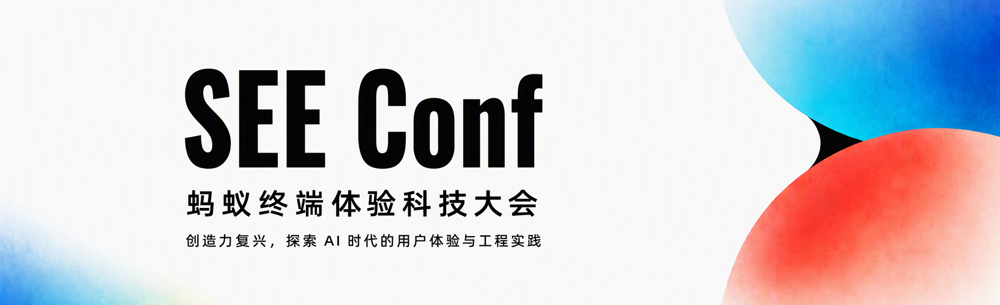

# SEE Conf 2026 来啦，创造力复兴，时代的你和我！

 SEE Conf 2026 将于 11 月 28 日在杭州 · 蚂蚁 A 空间盛大启幕  👉 大会官网：[点这里](https://seeconf.antgroup.com/)。



SEE Conf 蚂蚁终端体验科技大会，由蚂蚁终端技术委员会主办，是一场融合前沿分享、技术展台与沉浸式互动的科技盛会。

SEE 是 Seeking Experience & Engineering 的缩写，意为探索用户体验与工程实践。在这里，我们期待与业界同行共同分享和交流体验科技的最新进展，探讨切磋 AI 时代体验科技的未来发展，共同让生态繁荣共赢。

## 大会亮点

+ 主题聚焦：「创造力复兴，探索 AI 时代的用户体验与工程实践」
+ 全程一天：30+ 场以上演讲，等你来！ 上午主会场业界大佬云集、下午四大分会场平行展开：
    - AI 创新体验
    - 卓越 AI 工程实践
    - AI 新交互与多端
    - SEE Next
+ 丰富体验：现场设有 ~20 个技术展台，覆盖技术、产品、体验各个方面，带你近距离交流与产品体验。
+ 乐队表演：科技与激情双重碰撞，「996 x 万塘路 18 号 x 无共识」乐队首度联袂表演，带你 High 翻全场！


## 门票信息

+ 购票地址：[https://seeconf.antgroup.com](https://seeconf.antgroup.com/)
+ 超级早年票：79 元/张，仅限 1024 期间
+ 早鸟票：99 元/张
+ 普通票：199 元/张
+ 售票时间：即日起至 2026 年 11 月 24 日


⚠️ 温馨提示：由于场地容量有限，门票数量有限，先到先得，售完即止！

## 本地开发

```sh
npm ci
npm run dev
```

`npm run build` 生成静态页面，`npm run preview` 预览构建产物。

首页水彩由 Galacean `2.0.0-alpha.50` 渲染。ShaderLab 源码在
`src/effects/shaders/Watercolor.shader`；Vite 自动预编译到忽略提交的 `.compiled/`，
浏览器通过引擎 Shader Loader 加载产物，无需携带 Shader 编译器。
`src/effects/watercolor.js` 管理流体、纹理和生命周期，`HeroCursor.vue` 管理鼠标跟随。
桌面/移动背景及裁切仍由 `HeroBanner.vue` 的 CSS 决定。

水彩在组件挂载后异步加载，引擎单独构建为带内容哈希的 `galacean-*.js`，
与 `watercolor-*.js` 特效逻辑分开缓存。当前引擎生产文件约 1.67 M，离线 gzip 约
0.36 M、Brotli 约 0.27 M；实际传输量取决于部署服务是否启用对应压缩。
分包避免特效更新使引擎缓存失效，不会直接减少首次加载的引擎代码量。
使用 `npm run build` 后的产物评估线上体积；开发预构建和 source map 不代表生产包大小。
当前开发 URL 的 HTTP 响应约 9.28 M，其中约 2.97 M 是 JS、6.30 M 是内嵌 Base64
source map；这份调试映射不会进入生产构建。

验收时可在蓝色/红色区域移动鼠标观察显色、扩散和淡出，并检查 480px 断点的背景切换、
滚出首屏再返回、系统减少动态效果偏好。首屏文字禁止选中，参会指南文字保持可选择。
移动触摸设备的首屏只有底部“向下滚动探索”区域允许页面纵向滚动，也可点击进入参会指南；
其余首屏区域的触摸滑动用于水彩交互，双指缩放仍可用。桌面及第二页保持正常滚动。
WebGL2 或浮点渲染目标不可用、资源加载失败时保留 CSS 静态背景。

颜色查找表预先转换为无损 PNG atlas，两个文件合计 1,069 字节，与原 `.3dl`
在运行时生成的 RGBA8 数据逐字节一致。纸张法线按 256 CSS 像素平铺、渲染 DPR
上限 1.75 的采样需求预缩为 512×512，文件为 605,893 字节；这项缩放保留整体纸纹，
会有少量纹理采样差异。

六张水彩纹理通过 `afts upload` 上传，CDN 原图地址集中在 `watercolor.js` 的初始化处。
已验证 CDN 文件与上传源逐字节相同，并允许跨域纹理加载；LUT 必须使用原图地址，
不可添加有损压缩、调色或缩放参数。`public/` 不再包含这些纹理，避免重复部署。

原始资源保留在 PR #4 的 Git 历史中。重建查找表运行 `python3 scripts/convert-luts.py`；
重建法线运行 `python3 scripts/optimize-paper-normal.py`（需 Pillow）。两者均读取脚本内固定的源提交，
输出到忽略提交的 `assets.local/`。更新资源时执行 `afts upload assets.local/<文件名>`，
核对返回的原图数据后，将新 CDN 地址替换到 `watercolor.js`。
